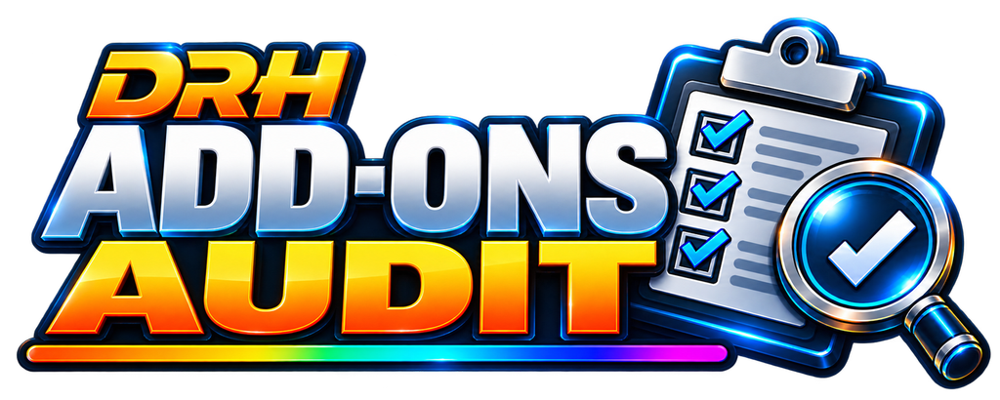
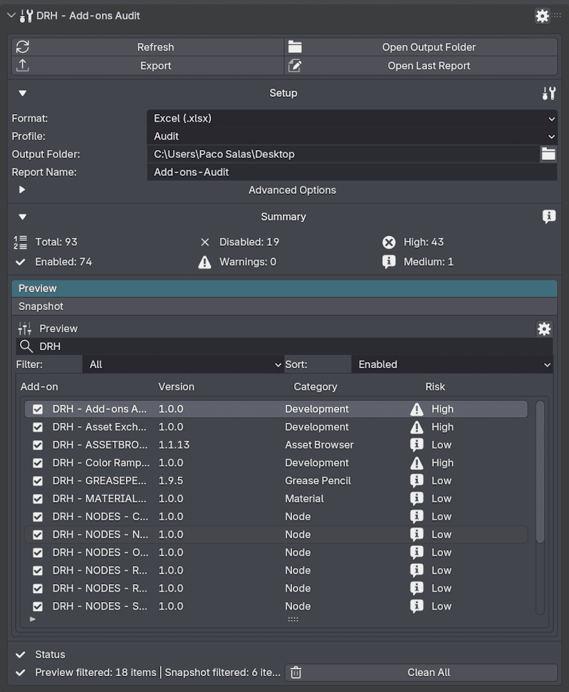

# DRH - Add-on Manager & Audit

**Forty add-ons. Three hotkey clashes. Two builds of the same tool. Find them before a render does.**

  

  

## The wall

Something in Blender started behaving oddly. You installed three add-ons last week. One of them may be an old copy sitting next to the new one, and Blender's own add-on list won't tell you which. Debugging by disabling tools one at a time takes an afternoon.

This add-on writes down what's installed, compares it against metadata and manifests, and points at the conflicts.

## What it looks at

Local add-on and extension inventory scanning, including the folders Blender doesn't show you by default. Manifest and add-on metadata review. Compatibility checks against the Blender version. Duplicate detection. Version conflicts between installs. Shadow states, where a second copy is loaded from a path that shouldn't win but does.

It also lists operator and hotkey review candidates, which is usually where the "why did Ctrl+Shift+S stop working" question gets answered.

## Snapshots, so changes are visible

Save a snapshot before you install something. Compare after. The diff tells you what appeared and what changed, which beats trying to remember whether a panel was always there. Reports export, so you can attach one to a support thread instead of describing your setup in prose.

## Who it's for

Anyone running more than twenty add-ons. People who support other Blender users and need to see their setup. Pipeline leads keeping machines consistent across a team.

## Get it

Free on BlendKit, Blender 4.2 or newer.

Bugs and requests: [open an issue](https://github.com/pacosalasv/DRH_Addons_Audit-Support/issues)

  

